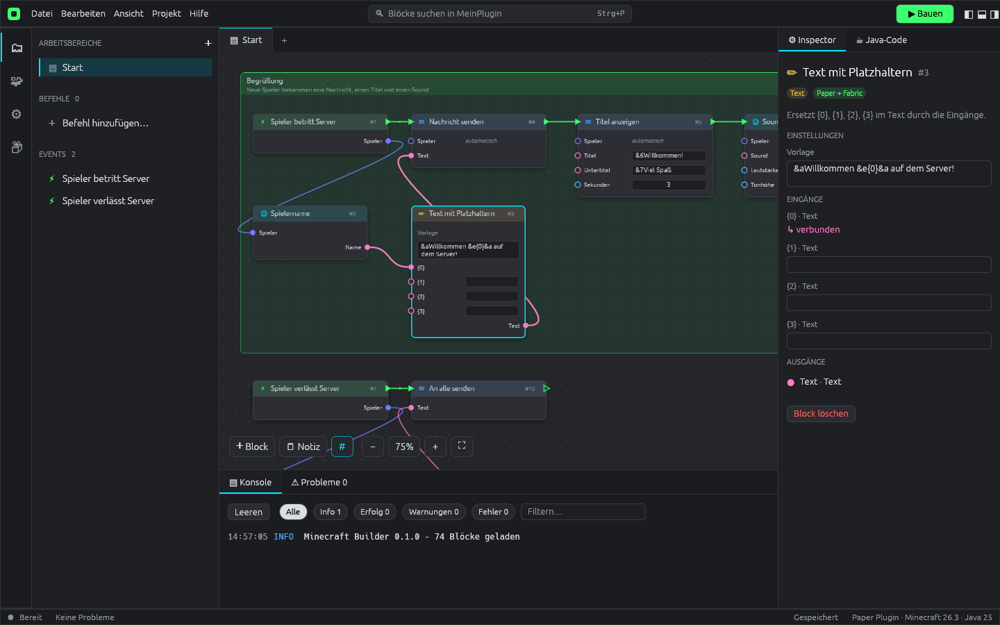

# Minecraft Builder

Baue **Minecraft-Plugins (Paper)** und **Mods (Fabric)**, indem du Blöcke verbindest – ganz ohne Java-Kenntnisse.
Komplett in **Rust** geschrieben (egui), läuft als einzelne **`.exe` unter Windows**.



## Was kann es?

- **Windows-Installer** mit Sprachauswahl (Deutsch/Englisch), Nutzungsbedingungen, Startmenü-/Desktop-Verknüpfung, `.mcb`-Dateizuordnung und **automatischer Einrichtung von Java & Gradle** während der Installation.
- **Einrichtungsassistent beim ersten Start**: Sprache wählen → Java & Gradle einrichten (oder überspringen) → **Tutorial** starten oder überspringen. Das Tutorial zeigt Schritt für Schritt mit Hervorhebungen, wo was ist.
- **Startseite** mit allen Projekten als Karten (Suche, „vor 2 Std.“, Plattform, Anzahl Blöcke/Befehle) und Vorlagen. Neue Projekte werden direkt unter `Dokumente/Minecraft Builder/` angelegt.
- **Node-Editor**: Events, Aktionen und Werte als Blöcke verbinden – per Ziehen **oder per Klick** (erst einen Punkt, dann den anderen anklicken). Kabel anklicken wählt sie aus (✕ oder Entf löscht), Doppelklick/Rechtsklick/Leertaste öffnet die Block-Suche, „⋯“-Menü an jedem Block, Notiz-Rahmen, Zoom, Raster, Mehrfachauswahl, Kopieren/Einfügen, Rückgängig.
- **Befehle-Fenster** (eigenes Fenster, wie bei XC Circuit): Befehle mit Name, Beschreibung, Aliasen, „Wer darf ihn benutzen“ (Alle / OP / Berechtigung), „Wer kann ihn ausführen“ (Spieler / Konsole) und **typisierten Optionen** (Wort, Text, Zahl, ganze Zahl, Spieler, Ja/Nein, Auswahl) – mit Pflicht-Schalter, Tab-Vorschlägen, automatischen Fehlermeldungen („… ist nicht online“, „… muss eine Zahl sein“), Vorschau „So sieht es in Minecraft aus“ und JSON-Ansicht. Jeder Befehl wird zum Event-Block „Befehl · /name“, dessen Ausgänge die Optionen sind.
- **Block-Suche** wie bei XC: Filter Alle/Events/Aktionen/Werte, aufklappbare Kategorien mit Anzahl, „Zuletzt“ und „Favoriten“, Detailansicht mit Ein- und Ausgängen.
- **Eigene Vektor-Icons** statt Emojis.
- **Texturen & Modelle**: Ein **Resourcepack (.zip)** hinzufügen – Modelle und Texturen (mit Vorschau) werden angezeigt.
  - **Paper**: Das Pack wird ins Plugin eingebaut; das Plugin liefert es über einen kleinen eingebauten Webserver aus und schickt es Spielern beim Betreten automatisch (Port, Pflicht, Text einstellbar).
  - **Fabric**: Texturen und Modelle werden direkt in den Mod eingebaut.
  - Block **„Eigenes Item geben“** (Item mit eigenem Modell, Namen und Beschreibung), **„Modell in der Hand“**, **„Hält Modell?“**, **„Resourcepack senden“**. Fehlende `items/*.json`-Definitionen werden automatisch erzeugt.
- **Zwei Plattformen** aus demselben Projekt:
  - **Paper-Plugin** (Minecraft 26.x und 1.21.11) – für Server, Spieler brauchen nichts zu installieren.
  - **Fabric-Mod** (Minecraft 26.x) – für Fabric-Server oder Einzelspieler.
- **96 Blöcke** in 11 Kategorien – u. a. **Inventar-Menüs** (Shops/Teleporter mit „Klick im Menü“), **Cooldown**, **Bossbar**, **Scoreboard-Seitenleiste**, **Tab-Liste**, Fliegen erlauben, Items zählen/abziehen, Wetter, „Spieler tötet Mob“, Entfernung, Zufallsspieler, Text ersetzen. Selten gebrauchte Eingänge sind am Block unter „weitere Optionen“ eingeklappt.
- **Ein Klick auf „▶ Bauen“ (F5)** erzeugt die fertige `.jar` – inklusive Gradle-Projekt, das auch in IntelliJ/VS Code weiterbearbeitet werden kann.
- **Live-Java-Vorschau**, **Probleme-Liste** mit Sprung zum Block, Konsole mit Filtern.

## Bauen der `.exe`

Voraussetzung: [Rust](https://rustup.rs/).

```bash
cargo build --release
# Ergebnis: target/release/minecraft-builder.exe
```

Von Linux aus für Windows:

```bash
rustup target add x86_64-pc-windows-gnu
sudo apt install mingw-w64
cargo build --release --target x86_64-pc-windows-gnu
```

Bei jedem Push baut GitHub Actions automatisch die Windows-`.exe` (Artefakt „minecraft-builder-windows-x64“) **und den Installer** (Artefakt „minecraft-builder-setup“) und prüft, dass das erzeugte Plugin und der Mod wirklich kompilieren. Ein neues **Release** (mit `.exe` und Installer) entsteht, wenn die Version in `Cargo.toml` erhöht und ein Commit mit `[release]` in der Nachricht gepusht wird (oder ein Tag `v*`). Installierte Apps finden das Update dann automatisch (Hilfe → „Nach Updates suchen…“) und installieren es beim Beenden.

Installer selbst bauen (Windows, [Inno Setup 6](https://jrsoftware.org/isinfo.php)):

```bat
cargo build --release
"C:\Program Files (x86)\Inno Setup 6\ISCC.exe" installer\setup.iss
:: Ergebnis: target\installer\MinecraftBuilder-Setup-<version>.exe
```

Für alte Grafiktreiber gibt es einen OpenGL-Build: `cargo build --release --no-default-features --features glow`.

## Benutzung

1. **Datei → Neues Projekt**: Plugin (Paper) oder Mod (Fabric) und eine Vorlage wählen.
2. **Rechtsklick** oder **Leertaste** auf der Fläche öffnet die Block-Suche. Alternativ aus der Block-Bibliothek (Seitenleiste) ziehen.
3. Jeder Ablauf startet bei einem **Event-Block**. Die **grünen Pfeile** bestimmen die Reihenfolge, die **farbigen Punkte** sind Werte (Spieler, Text, Zahl, Position …).
4. Ein Kabel **ins Leere ziehen** zeigt nur passende Blöcke und verbindet sie automatisch.
5. Nicht verbundene Spieler-Eingänge nehmen automatisch den Spieler aus dem Event.
6. Farbcodes in Texten: `&a` grün, `&c` rot, `&e` gelb, `&l` fett …
7. **▶ Bauen** (F5). Die `.jar` kommt bei Paper nach `plugins/`, bei Fabric nach `mods/` (zusammen mit der Fabric API). Unter „Bauen & Export“ kann ein Test-Server-Ordner eingetragen werden – die `.jar` wird dann automatisch dorthin kopiert.

**Java & Gradle** richtet der Installer bzw. der Einrichtungsassistent automatisch ein (Java 25 wird bei Bedarf nach `%LOCALAPPDATA%\MinecraftBuilder\jdk` geladen). Ohne Einrichtung lädt Gradle, das passende JDK (25 für Minecraft 26.x) und die Minecraft-Bibliotheken automatisch herunter und dauert daher einige Minuten. Danach geht es schnell.

### Tastenkürzel

| Taste | Aktion |
|---|---|
| Doppelklick / Rechtsklick / Leertaste | Block hinzufügen |
| Klick auf Pin, dann Klick auf anderen Pin | Verbinden |
| Klick auf Kabel, dann Entf | Kabel löschen |
| Entf | Auswahl löschen |
| Strg+C / Strg+V / Strg+D | Kopieren / Einfügen / Duplizieren |
| Strg+Z / Strg+Y | Rückgängig / Wiederholen |
| Strg+S / Strg+O / Strg+N | Speichern / Öffnen / Neu |
| F5 | Bauen |
| F | Alles anzeigen |
| Mausrad | Zoomen |
| Ziehen auf leerer Fläche / mittlere Maustaste | Ansicht verschieben |
| Shift + Ziehen | Mehrere Blöcke auswählen |
| Rechtsklick auf Pin | Verbindungen trennen |

## Projektaufbau

| Datei | Inhalt |
|---|---|
| `src/blocks.rs` | Alle Block-Definitionen mit Java-Vorlagen für Paper und Fabric |
| `src/codegen.rs` | Wandelt die Block-Graphen in ein Gradle-Projekt mit Java-Code um |
| `src/build.rs` | Export, Gradle-Aufruf, Java-Suche, Online-Versionsabfrage |
| `src/model.rs` | Projektformat (`.mcb`, JSON) |
| `src/ui/` | Oberfläche: Canvas, Seitenleisten, Inspector, Konsole, Dialoge |
| `assets/templates/` | Java-Hilfsklassen, die in jedes Plugin/jeden Mod kommen |

Kommandozeile (für Tests/Skripte):

```bash
minecraft-builder projekt.mcb                       # Projekt öffnen
minecraft-builder --export projekt.mcb ausgabe/     # nur exportieren
minecraft-builder --selftest paper|fabric ausgabe/  # Testprojekt mit allen Blöcken
minecraft-builder --setup-tools                     # Java & Gradle einrichten (nutzt der Installer)
minecraft-builder --lang de|en                      # Sprache setzen (nutzt der Installer)
```

Nicht offiziell von Mojang oder Microsoft. Die Oberfläche ist von node-basierten Bot-Buildern wie XC Circuit inspiriert, der Code ist eigenständig.
