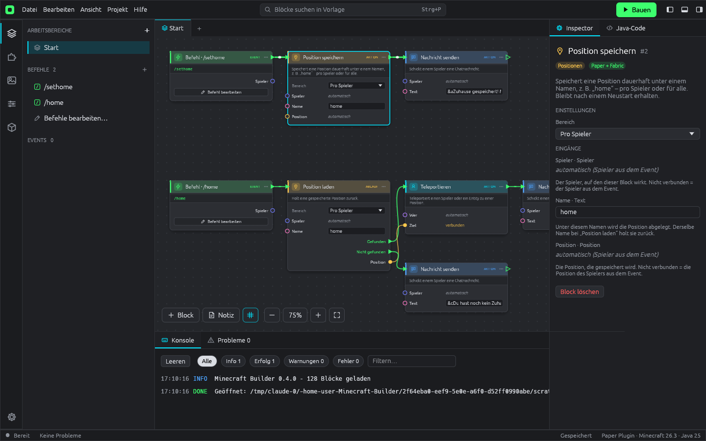

# Minecraft Builder

Baue **Minecraft-Plugins (Paper)** und **Mods (Fabric)**, indem du Blöcke verbindest – ganz ohne Java-Kenntnisse.
Komplett in **Rust** geschrieben (egui), läuft als einzelne **`.exe` unter Windows**.



## Was kann es?

- **Windows-Installer** mit Sprachauswahl (Deutsch/Englisch), Nutzungsbedingungen, Startmenü-/Desktop-Verknüpfung, `.mcb`-Dateizuordnung und **automatischer Einrichtung von Java & Gradle** während der Installation.
- **Einrichtungsassistent beim ersten Start**: Sprache wählen → Java & Gradle einrichten (oder überspringen) → **Tutorial** starten oder überspringen. Das Tutorial zeigt Schritt für Schritt mit Hervorhebungen, wo was ist.
- **Startseite** mit allen Projekten als Karten (Suche, „vor 2 Std.“, Plattform, Anzahl Blöcke/Befehle) und Vorlagen. Neue Projekte werden direkt unter `Dokumente/Minecraft Builder/` angelegt.
- **Node-Editor**: Events, Aktionen und Werte als Blöcke verbinden – per Ziehen **oder per Klick** (erst einen Punkt, dann den anderen anklicken). Kabel anklicken wählt sie aus (✕ oder Entf löscht), Doppelklick/Rechtsklick/Leertaste öffnet die Block-Suche, „⋯“-Menü an jedem Block, Notiz-Rahmen, Zoom, Raster, Mehrfachauswahl, Kopieren/Einfügen, Rückgängig.
- **Befehle-Fenster** (eigenes Fenster, wie bei XC Circuit): Befehle mit Name, Beschreibung, Aliasen, „Wer darf ihn benutzen“ (Alle / OP / Berechtigung), „Wer kann ihn ausführen“ (Spieler / Konsole) und **typisierten Optionen** (Wort, Text, Zahl, ganze Zahl, Spieler, Ja/Nein, Auswahl) – mit Pflicht-Schalter, Tab-Vorschlägen, automatischen Fehlermeldungen („… ist nicht online“, „… muss eine Zahl sein“), Vorschau „So sieht es in Minecraft aus“ und JSON-Ansicht. Jeder Befehl wird zum Event-Block „Befehl · /name“, dessen Ausgänge die Optionen sind.
- **Block-Suche** wie bei XC: Filter Alle/Events/Aktionen/Werte, aufklappbare Kategorien mit Anzahl, „Zuletzt“ und „Favoriten“, Detailansicht mit Ein- und Ausgängen.
- **Eigene Vektor-Icons** statt Emojis.
- **Texturen & Modelle**: **Mehrere Resourcepacks (.zip)** hinzufügen – sie werden zu **einem Pack zusammengeführt** (Reihenfolge = Vorrang; Sprach-, Sound-, Atlas- und Schrift-Dateien werden gemischt statt ersetzt).
  - **Einstellungen pro Item**: „Ersetzt Vanilla-Item“, „Nur per Befehl / Block“ oder „Aus“. Ersetzt ein Pack z. B. das Diamantschwert, kann es stattdessen als eigenes Item nur per Befehl erhältlich gemacht werden – das Vanilla-Schwert bleibt dann normal. Umgekehrt kann ein eigenes Modell ein Vanilla-Item ersetzen.
  - **Item-Befehl**: Auf Wunsch erzeugt der Builder `/items <item> [anzahl] [spieler]` (nur OPs, mit Tab-Vorschlägen), der alle eigenen Items ausgibt.
  - **Paper**: Das Pack wird ins Plugin eingebaut; das Plugin liefert es über einen kleinen eingebauten Webserver aus und schickt es Spielern beim Betreten automatisch (Port, Pflicht, Text einstellbar).
  - **Fabric**: Texturen und Modelle werden direkt in den Mod eingebaut.
  - Blöcke: **„Eigenes Item geben“**, **„Rechtsklick mit eigenem Item“**, **„Modell des Items ändern“**, **„Eigenes Item anziehen / fallen lassen“**, **„Eigene Items zählen / abziehen“**, **„Resourcepack-Status“**, **„Resourcepack senden / entfernen“**. Fehlende `items/*.json`-Definitionen werden automatisch erzeugt.
- **Menü-Editor**: Der Block „Menü öffnen“ hat den Knopf **„Menü bearbeiten“**. Im Editor stellst du Reihen und Titel ein und siehst die Kiste **wie in Minecraft**. Klick auf einen Platz öffnet die **Item-Suche über alle 1500 Items und Blöcke**; pro Platz gibt es Name, Beschreibung, Anzahl, eigenes Modell und den Schalter **„Kann herausgenommen werden“**. Items lassen sich per Ziehen verschieben. Jeder Platz kann eine **ID** bekommen; der Block „Klick im Menü“ reagiert dann nur auf dieses Item.
- **MCP für KI-Assistenten** (Bereich „Plugins“ in der linken Leiste): Ein eingebauter MCP-Server (HTTP, nur auf diesem Computer, Adresse mit geheimem Teil). Eine KI wie Claude kann damit das offene Projekt lesen, Blöcke suchen, hinzufügen, verbinden, Werte setzen, Befehle anlegen, Probleme lesen und bauen. Einrichten per Klick: Bei Claude Desktop, Claude Code, Cursor oder VS Code auf **Hinzufügen** drücken – der Builder trägt sich selbst in deren Einstellungen ein (Sicherung der alten Datei als `.mcb-backup`), danach das KI-Programm einmal neu starten. Der Builder muss dabei mit einem Projekt offen sein. Andere Programme: `minecraft-builder --mcp-stdio` als Befehl eintragen oder die HTTP-Adresse verwenden.
- **Bereiche verschieben**: Jeder Bereich (Konsole, Probleme, Server-Konsole, Inspector, Java-Code, Bauen & Export, Block-Bibliothek …) lässt sich per Ziehen des Reiters bzw. Symbols oder per Rechtsklick nach links, rechts oder unten setzen; die Anordnung wird gespeichert.
- **Bann-System**: Blöcke „Bannen“ (Minuten/Stunden/Tage/für immer), „Entbannen“, „Ist gebannt?“ und „Grund (Bildschirm)“ mit Kategorien. Der Bildschirm-Editor zeigt den „Verbindung getrennt“-Bildschirm wie in Minecraft; `{time}` wird zur Restzeit, `{player}` zum Namen. Der Grund lässt sich mit „Bannen“ oder „Kicken“ verbinden.
- **Variablen & Listen**: Werte bis zum Server-Stopp merken, hochzählen, Listen füllen und mit „Für jeden Eintrag“ durchgehen.
- **Countdown** pro Spieler mit Abbrechen, **eigene Blöcke** (Ablauf unter einem Namen, von überall ausführbar), **Nachrichten aus messages.yml**.
- **Mehr Events**: Block angeklickt, Spieler bewegt sich, Bereich betreten/verlassen, schleichen, springen, Welt gewechselt, Respawn, Item aufgehoben/weggeworfen, NPC angeklickt.
- **Hologramme & NPCs**, **Geld** (Kontostand, geben, abziehen), **Rang-Präfix und Berechtigungen**.
- **Server-Konsole in der App** (Reiter unten): zeigt die Konsole des verbundenen Calagopus-Servers, sendet Befehle, startet/stoppt ihn.
- **Suchen & Ersetzen** im ganzen Projekt (Bearbeiten-Menü) und **Sound-Auswahl** (♪) mit den Sounds deines Resourcepacks.
- **Klick-Aktionen ohne Kabel**: Im Menü-Editor stellst du pro Platz ein, was ein Klick macht – Menü schließen, anderes Menü öffnen, Befehl als Spieler/Konsole, Nachricht, Position speichern, zu gespeicherter Position oder zu einem Warp teleportieren.
- **Menü-Seiten**: „Weitere Seite anlegen“ erstellt ein zweites Menü und setzt die Vor-/Zurück-Pfeile automatisch.
- **Menü-Namen zum Auswählen** bei „Klick im Menü“, „Menü ersetzen“ und „Menü zurücksetzen“; passt ein Name zu keinem Menü, gibt es eine Warnung.
- **Automatisch verbinden**: Neue Aktions-Blöcke hängen sich an den vorher ausgewählten Block (oder den nächsten freien grünen Pfeil links davon). Fehlt der Ablauf trotzdem, steht die Erklärung direkt am Block, mit Knopf „Mit Ablauf verbinden“.
- **Testen**: Der Knopf „Testen“ (oder „Ablauf ausprobieren“ im Block-Menü eines Events) zeigt Schritt für Schritt, welche Blöcke in welcher Reihenfolge laufen, lässt sie aufleuchten und listet Blöcke, die nie laufen.
- **Debug-Meldungen im Spiel** (Bauen & Export → Fehlersuche): OPs sehen im Chat, welches Event für wen läuft.
- **Menü ersetzen / zurücksetzen**: Für einen Spieler (oder alle) entweder das **ganze Menü** oder **nur einzelne Plätze** austauschen, z. B. nach einem Befehl. Im Platz-Modus siehst du das Original blass im Hintergrund; per Rechtsklick lassen sich Original-Items auch entfernen. Bleibt nach Neustart erhalten, ein offenes Menü wird sofort ausgetauscht.
- **Rezepte**: Block „Rezept“ mit einem Editor wie die Werkbank – Werkbank mit/ohne Form, Ofen, Räucherofen, Schmelzofen, Lagerfeuer, Steinsäge. Das Ergebnis kann ein eigenes Item mit Name, Beschreibung und Resourcepack-Modell sein. Paper registriert das Rezept beim Start und schaltet es im Rezeptbuch frei, Fabric bekommt es als Datenpaket-Rezept. Items werden **wie im Inventar** gezeichnet: Blöcke als 3D-Würfel (aus ihren Block-Modellen, auch Treppen, Stufen, Zäune, Glas, Laub mit Farbe), Items flach, Truhen, Köpfe, Shulker-Kisten, Banner und Schilde aus ihren Entity-Texturen. Texturen und Modelle kommen aus deinem Resourcepack und aus einem **Minecraft-Texturen-Pack** (Vanilla-Template-.zip, unter Einstellungen → Darstellung wählen) oder der Minecraft-.jar auf dem Computer; ohne beides gibt es Platzhalter-Bilder. Items, die das Texturen-Pack kennt, aber die eingebaute Liste nicht (neuere Versionen), erscheinen automatisch in der Suche. Minecraft-Dateien werden nicht mit dem Builder ausgeliefert.
- **Positionen**: „Position holen“ (Koordinaten + Welt), „Position speichern / laden / löschen“, „Position im Blick“, „Blockmitte“, „In Bereich?“, „Welt-Spawn“, „Bett / Respawn-Punkt“, „Oberfläche“.
- **Dateien & Einstellungen**: „Ordner erstellen“ (in `plugins/<Name>/` bzw. `config/<id>/`), „Einstellung anlegen / lesen / ändern / neu laden“ für eigene `settings.yml`-Dateien, „Datei schreiben / lesen / löschen“, „Zeile anhängen“, „Dateien im Ordner“.
- **Server-Upload**: Unter Einstellungen → Server die Adresse deines **Calagopus-Panels** eingeben – der Browser öffnet die Seite „API-Key erstellen“, der kopierte Key wird automatisch übernommen, dann nur noch den Server wählen. Nach jedem Build landet die `.jar` automatisch in `plugins/` bzw. `mods/` (alte Versionen werden entfernt; optional Neustart oder Konsolenbefehl danach). Mit dem Häkchen „Beim Hochladen plugins/<Name>/ löschen“ wird zusätzlich der Datenordner des Plugins gelöscht (Fabric: `config/<id>/`), auch im lokalen Test-Server – das Plugin startet dann wie neu, alle gespeicherten Daten sind weg.
- **Einstellungen** (Zahnrad unten links, immer sichtbar): Sprache, Größe der Oberfläche, Block-Beschreibungen, Typ-Marken, Block-Nummern, Raster, Item-Bilder, Server, Updates.
- **Erklärungen an jedem Sockel**: Mit der Maus über einen Ein- oder Ausgang (z. B. „Spieler“) gehen zeigt, was er macht, welchen Typ er hat und was hineinpasst.
- **Vorlagen je nach Plattform**: 15 Vorlagen für Plugins, 10 für Mods – u. a. /sethome & /home, mehrere Homes mit /homes, Home-Menü, Warp-Menü, Shop-Menü, Einstellungs-Datei, Zauberstab, Spawn-Schutz.
- **Zwei Plattformen** aus demselben Projekt:
  - **Paper-Plugin** (Minecraft 26.x und 1.21.11) – für Server, Spieler brauchen nichts zu installieren.
  - **Fabric-Mod** (Minecraft 26.x) – für Fabric-Server oder Einzelspieler.
- **167 Blöcke** in 16 Kategorien – jeder Block zeigt eine Kurzbeschreibung, seinen Typ (Event/Aktion/Wert) und farbige Typ-Marken. U. a. **Inventar-Menüs** (Shops/Teleporter mit „Klick im Menü“), **Cooldown**, **Bossbar**, **Scoreboard-Seitenleiste**, **Tab-Liste**, Fliegen erlauben, Items zählen/abziehen, Wetter, „Spieler tötet Mob“, Entfernung, Zufallsspieler, Text ersetzen. Selten gebrauchte Eingänge sind am Block unter „weitere Optionen“ eingeklappt.
- **Ein Klick auf „▶ Bauen“ (F5)** erzeugt die fertige `.jar` – inklusive Gradle-Projekt, das auch in IntelliJ/VS Code weiterbearbeitet werden kann.
- **Live-Java-Vorschau**, **Probleme-Liste** mit Sprung zum Block, Konsole mit Filtern.

## Bauen der `.exe`

Voraussetzung: [Rust](https://rustup.rs/).

```bash
cargo build --release
# Ergebnis: target/release/minecraft-builder.exe
```

Von Linux aus für Windows:

```bash
rustup target add x86_64-pc-windows-gnu
sudo apt install mingw-w64
cargo build --release --target x86_64-pc-windows-gnu
```

Bei jedem Push baut GitHub Actions automatisch die Windows-`.exe` (Artefakt „minecraft-builder-windows-x64“) **und den Installer** (Artefakt „minecraft-builder-setup“) und prüft, dass das erzeugte Plugin und der Mod wirklich kompilieren. Ein neues **Release** (mit `.exe` und Installer) entsteht, wenn die Version in `Cargo.toml` erhöht und ein Commit mit `[release]` in der Nachricht gepusht wird (oder ein Tag `v*`). Installierte Apps finden das Update dann automatisch (Hilfe → „Nach Updates suchen…“) und installieren es beim Beenden.

Installer selbst bauen (Windows, [Inno Setup 6](https://jrsoftware.org/isinfo.php)):

```bat
cargo build --release
"C:\Program Files (x86)\Inno Setup 6\ISCC.exe" installer\setup.iss
:: Ergebnis: target\installer\MinecraftBuilder-Setup-<version>.exe
```

Für alte Grafiktreiber gibt es einen OpenGL-Build: `cargo build --release --no-default-features --features glow`.

## Benutzung

1. **Datei → Neues Projekt**: Plugin (Paper) oder Mod (Fabric) und eine Vorlage wählen.
2. **Rechtsklick** oder **Leertaste** auf der Fläche öffnet die Block-Suche. Alternativ aus der Block-Bibliothek (Seitenleiste) ziehen.
3. Jeder Ablauf startet bei einem **Event-Block**. Die **grünen Pfeile** bestimmen die Reihenfolge, die **farbigen Punkte** sind Werte (Spieler, Text, Zahl, Position …).
4. Ein Kabel **ins Leere ziehen** zeigt nur passende Blöcke und verbindet sie automatisch.
5. Nicht verbundene Spieler-Eingänge nehmen automatisch den Spieler aus dem Event.
6. Farbcodes in Texten: `&a` grün, `&c` rot, `&e` gelb, `&l` fett …
7. **▶ Bauen** (F5). Die `.jar` kommt bei Paper nach `plugins/`, bei Fabric nach `mods/` (zusammen mit der Fabric API). Unter „Bauen & Export“ kann ein Test-Server-Ordner eingetragen werden – die `.jar` wird dann automatisch dorthin kopiert.

**Java & Gradle** richtet der Installer bzw. der Einrichtungsassistent automatisch ein (Java 25 wird bei Bedarf nach `%LOCALAPPDATA%\MinecraftBuilder\jdk` geladen). Ohne Einrichtung lädt Gradle, das passende JDK (25 für Minecraft 26.x) und die Minecraft-Bibliotheken automatisch herunter und dauert daher einige Minuten. Danach geht es schnell.

### Tastenkürzel

| Taste | Aktion |
|---|---|
| Doppelklick / Rechtsklick / Leertaste | Block hinzufügen |
| Klick auf Pin, dann Klick auf anderen Pin | Verbinden |
| Klick auf Kabel, dann Entf | Kabel löschen |
| Entf | Auswahl löschen |
| Strg+C / Strg+V / Strg+D | Kopieren / Einfügen / Duplizieren |
| Strg+Z / Strg+Y | Rückgängig / Wiederholen |
| Strg+S / Strg+O / Strg+N | Speichern / Öffnen / Neu |
| F5 | Bauen |
| F | Alles anzeigen |
| Mausrad | Zoomen |
| Ziehen auf leerer Fläche / mittlere Maustaste | Ansicht verschieben |
| Shift + Ziehen | Mehrere Blöcke auswählen |
| Rechtsklick auf Pin | Verbindungen trennen |

## Projektaufbau

| Datei | Inhalt |
|---|---|
| `src/blocks.rs` | Alle Block-Definitionen mit Java-Vorlagen für Paper und Fabric |
| `src/codegen.rs` | Wandelt die Block-Graphen in ein Gradle-Projekt mit Java-Code um |
| `src/build.rs` | Export, Gradle-Aufruf, Java-Suche, Online-Versionsabfrage |
| `src/model.rs` | Projektformat (`.mcb`, JSON) |
| `src/resourcepack.rs` | Resourcepacks lesen, zusammenführen, Item-Regeln anwenden |
| `src/mcp.rs` | MCP-Server für KI-Assistenten |
| `src/server.rs` | Upload auf den Server (Calagopus-Panel) |
| `src/recipe.rs` | Rezepte: Datenformat, Paper-Code und Fabric-JSON |
| `src/items.rs` | Liste aller Items und Blöcke für die Suche |
| `src/item_render.rs` | Zeichnet Items wie im Inventar (3D-Blöcke, flache Items) aus Pack-Modellen |
| `src/ui/` | Oberfläche: Canvas, Seitenleisten, Inspector, Konsole, Dialoge |
| `assets/templates/` | Java-Hilfsklassen, die in jedes Plugin/jeden Mod kommen |

Kommandozeile (für Tests/Skripte):

```bash
minecraft-builder projekt.mcb                       # Projekt öffnen
minecraft-builder --export projekt.mcb ausgabe/     # nur exportieren
minecraft-builder --selftest paper|fabric ausgabe/  # Testprojekt mit allen Blöcken
minecraft-builder --setup-tools                     # Java & Gradle einrichten (nutzt der Installer)
minecraft-builder --lang de|en                      # Sprache setzen (nutzt der Installer)
minecraft-builder --render-item pack.zip ausgabe/ stone chest   # Item-Bilder als PNG
minecraft-builder --selftest-project paper test.mcb  # Testprojekt mit allen Blöcken als .mcb (Lasttest)
```

Mit der Umgebungsvariable `MCB_PROFILE=1` schreibt der Builder alle 120 Bilder auf, wie viele Millisekunden jeder Teil der Oberfläche braucht (zum Finden von Rucklern).

Nicht offiziell von Mojang oder Microsoft. Die Item-Liste (`assets/items.txt`) stammt aus dem offenen Projekt [minecraft-data](https://github.com/PrismarineJS/minecraft-data) (MIT-Lizenz). Die Oberfläche ist von node-basierten Bot-Buildern wie XC Circuit inspiriert, der Code ist eigenständig.
